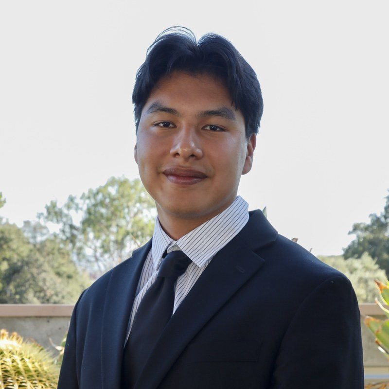
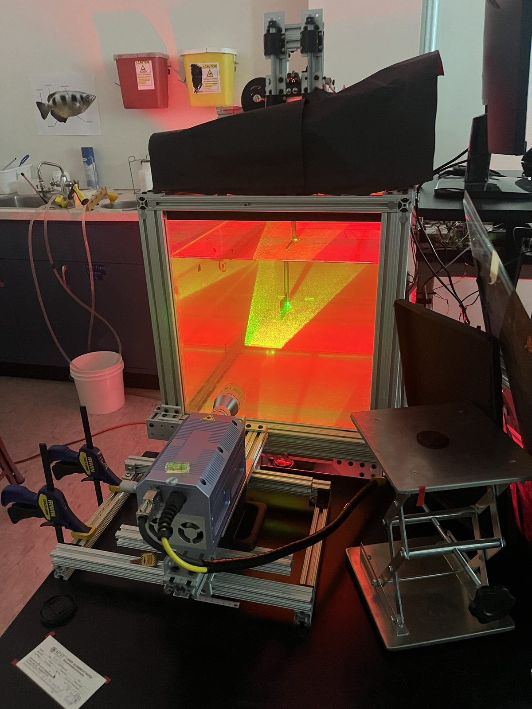
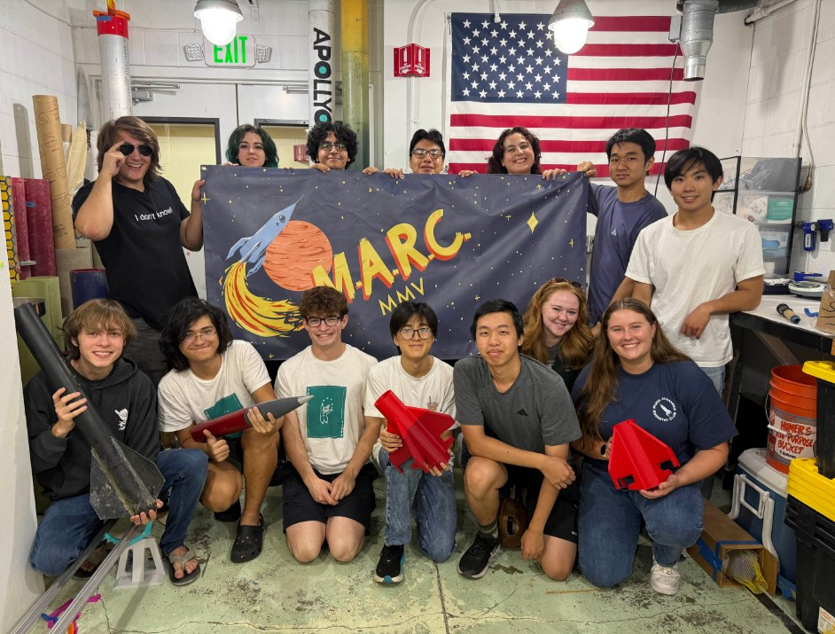
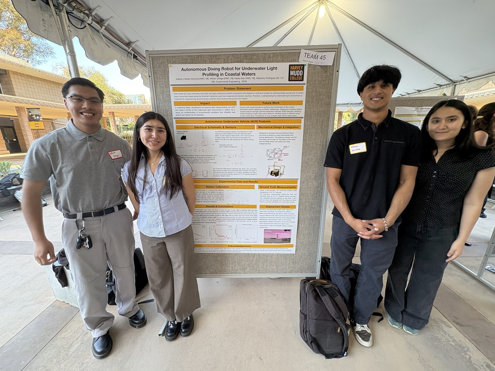
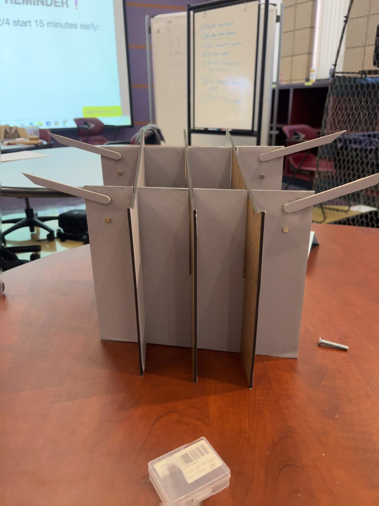
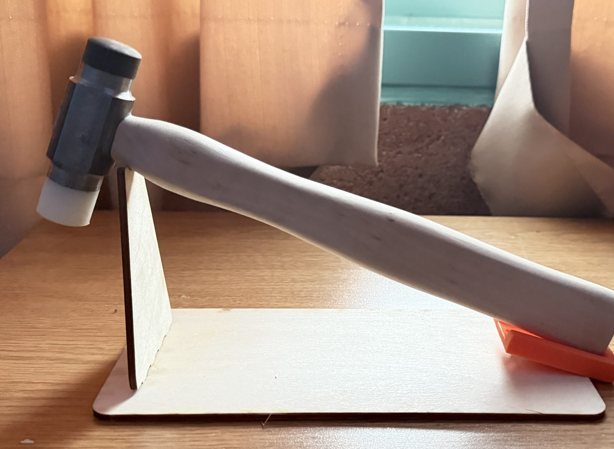
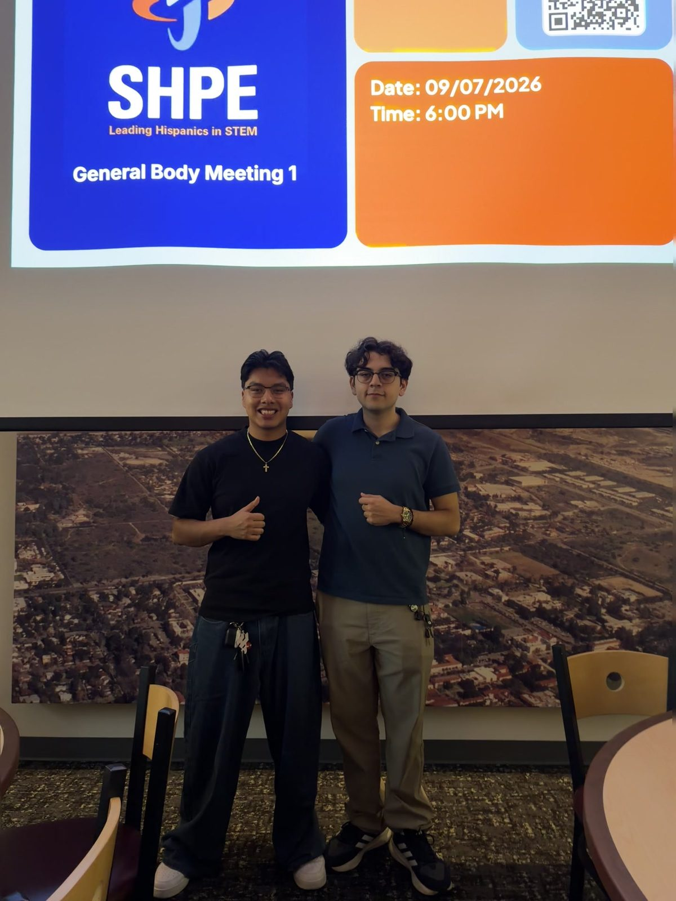

```{=html}
<section class="hero">
  <div class="hero-photo">
    
  </div>
  <div class="hero-text">
    <span class="eyebrow"><a href="https://www.hmc.edu/" target="_blank">Harvey Mudd College</a> · B.S. Engineering · 2028</span>
    <h1 class="hero-name">William Ortega</h1>
    <p class="hero-tagline">I design, build, and test hardware for <strong>propulsion, fluid dynamics, and aerospace systems</strong>, from flapping-fin thrust experiments to rocket canards.</p>
    <div class="hero-actions">
      <a class="btn btn-primary" href="resume.html">View Resume</a>
      <a class="btn btn-outline" href="projects.html">See Projects</a>
      <a class="btn btn-outline" href="mailto:wortega@g.hmc.edu">Email Me</a>
    </div>
  </div>
</section>
```

## Currently

```{=html}
<div class="now-grid">
  <div class="now-item">
    <div class="now-label">Research</div>
    <p>Undergraduate researcher in the <a href="research.html">Flow Imaging Lab</a>, studying bio-inspired flapping-fin propulsion.</p>
  </div>
  <div class="now-item">
    <div class="now-label">Rocketry</div>
    <p>Propulsion subteam, Mudd Amateur Rocketry Club: canard sizing in OpenRocket and Ansys CFD.</p>
  </div>
  <div class="now-item">
    <div class="now-label">Leadership</div>
    <p>Co-Founder &amp; Co-President of Harvey Mudd's <a href="leadership.html">SHPE chapter</a>.</p>
  </div>
  <div class="now-item">
    <div class="now-label">Looking for</div>
    <p>Summer 2027 internships in propulsion, fluids, test, and mechanical engineering.</p>
  </div>
</div>
```

## Featured Work

```{=html}
<div class="card-grid">
  <a class="work-card" href="research.html">
    <div class="thumb"></div>
    <div class="body">
      <span class="tag">Research</span>
      <h3>Flapping-Fin Propulsion</h3>
      <p>Built an 80/20 laser frame and a milled fin mount, then ran 100+ trials with a peak trial-averaged thrust coefficient of about 4.9.</p>
    </div>
  </a>
  <a class="work-card" href="research.html#marc">
    <div class="thumb"></div>
    <div class="body">
      <span class="tag">Rocketry</span>
      <h3>Competition Rocket Canards</h3>
      <p>Sized canards to keep stability above 1.2 calibers and set up Ansys CFD for the flight controller.</p>
    </div>
  </a>
  <a class="work-card" href="projects.html#autonomous-underwater-vehicle-auv">
    <div class="thumb"></div>
    <div class="body">
      <span class="tag">Class Project</span>
      <h3>Autonomous Underwater Vehicle</h3>
      <p>Custom sensor board and depth control; measured &gt;80% light loss by 3 m off Dana Point.</p>
    </div>
  </a>
  <a class="work-card" href="projects.html#mobile-lectern">
    <div class="thumb"></div>
    <div class="body">
      <span class="tag">Client Design</span>
      <h3>Mobile Lectern</h3>
      <p>A $24 collapsible lectern for a professor client that sets up in 1.6 s and holds over 12 lb.</p>
    </div>
  </a>
  <a class="work-card" href="projects.html#machinists-hammer">
    <div class="thumb"></div>
    <div class="body">
      <span class="tag">Manufacturing</span>
      <h3>Machinist's Hammer</h3>
      <p>Machined from raw steel and nylon to ±0.001 in. on manual mills and lathes.</p>
    </div>
  </a>
  <a class="work-card" href="leadership.html">
    <div class="thumb"></div>
    <div class="body">
      <span class="tag">Leadership</span>
      <h3>SHPE Harvey Mudd</h3>
      <p>Co-founded the chapter, grew it to 52 students, and secured $10K for the 2026 National Convention.</p>
    </div>
  </a>
</div>
```
