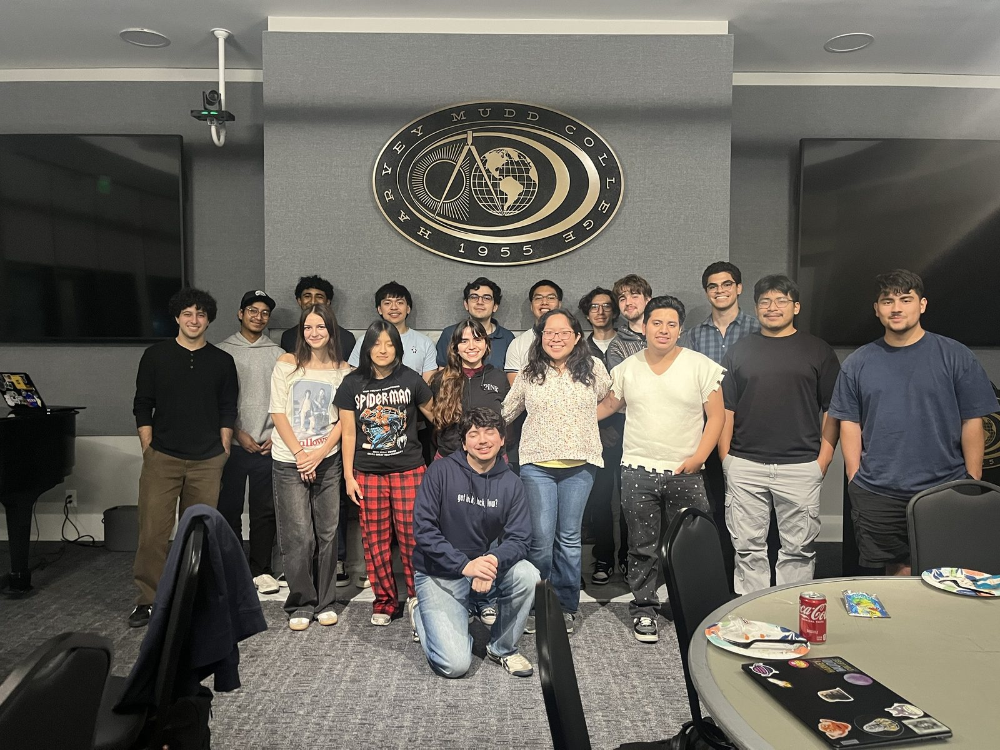
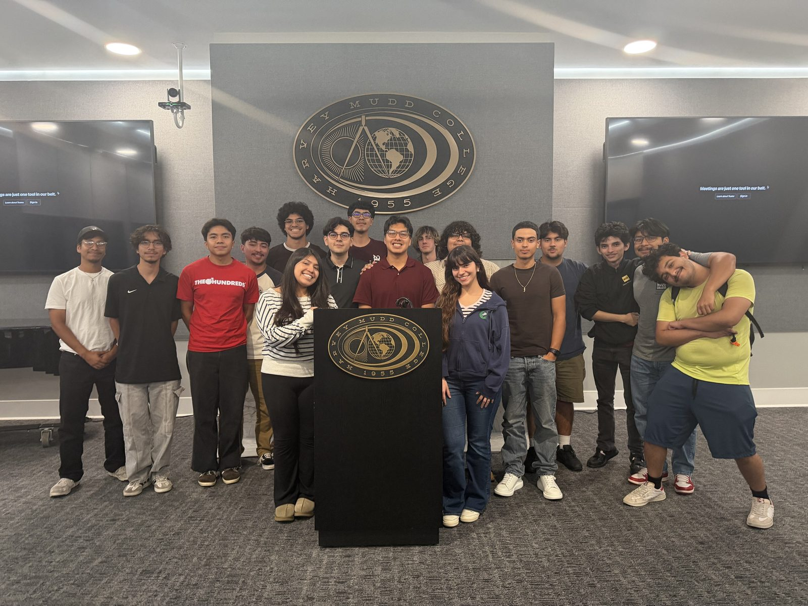
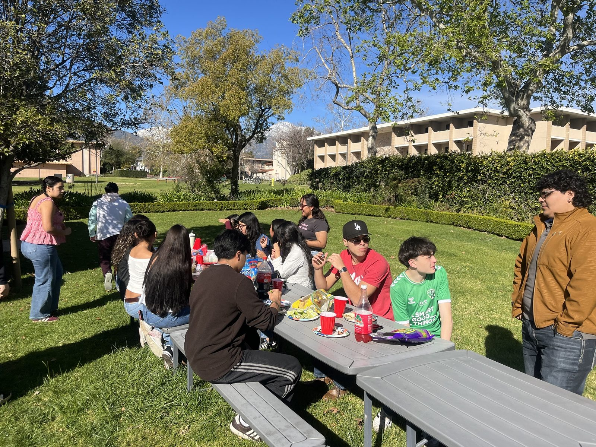
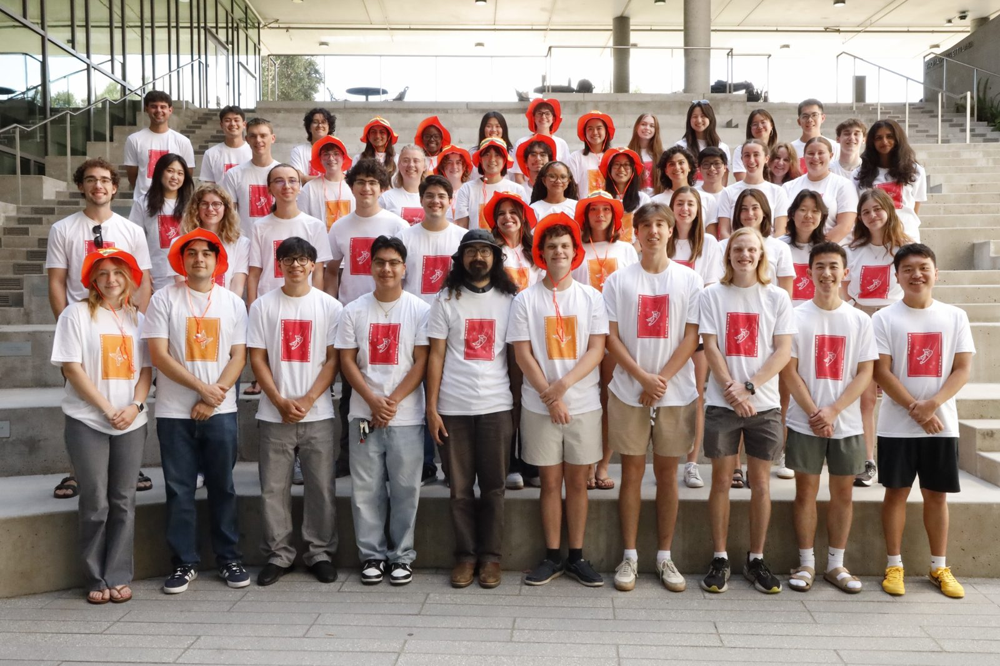
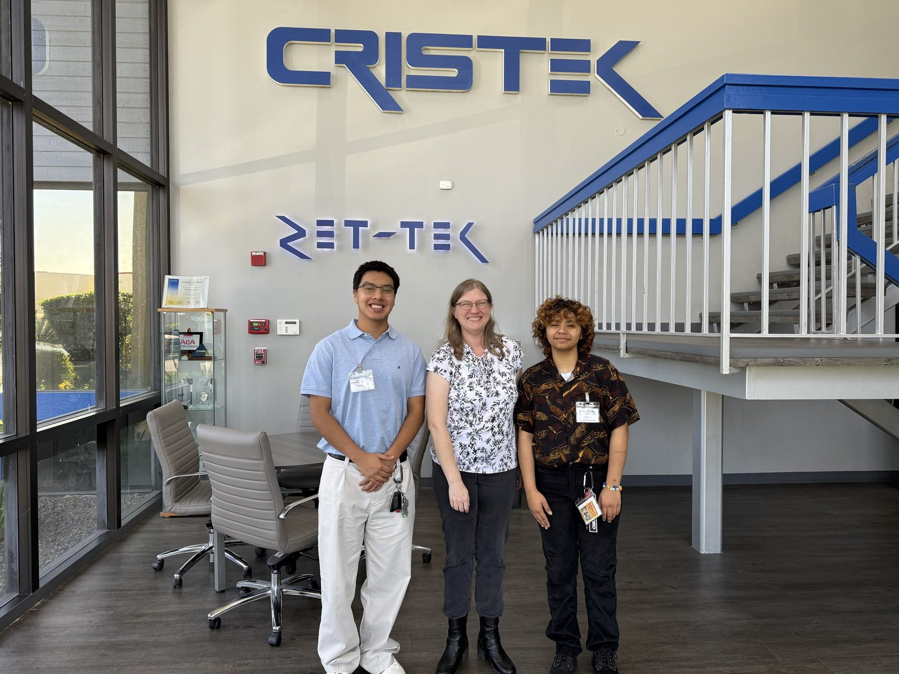

# Leadership & Community

I have focused much of my campus leadership on **building professional-development opportunities, strengthening community, and supporting students through their transition into college**.

---

## Society of Hispanic Professional Engineers — Harvey Mudd College

**Co-Founder & Co-President | January 2026 – Present**

I co-founded Harvey Mudd College's SHPE chapter to expand access to professional development, networking, and engineering opportunities for students across campus.

:::: {.columns}

::: {.column width="50%"}

*SHPE Harvey Mudd co-presidents at General Body Meeting 1, Fall 2026.*

:::

::: {.column width="50%"}

*HMC SHPE representation at a SHPE professional-development conference.*

:::

::::

### Building the Chapter

- Co-founded the Harvey Mudd SHPE chapter and helped establish its initial leadership structure and programming
- Grew chapter engagement to approximately **52 students** through recruiting, campus outreach, and community-building efforts
- Developed programming centered on engineering careers, technical skills, networking, and professional development
- Built collaborations with Harvey Mudd departments and student organizations to expand opportunities for members

### Funding & National Convention

Working with my co-president, I helped secure approximately **$10,000 in first-year institutional funding** to support student professional development and participation in the 2026 SHPE National Convention.

Funding efforts included outreach to:

- Harvey Mudd Engineering Department
- ASHMC
- Student Opportunity Fund
- Other institutional funding channels

We also developed an application and selection process for the chapter's national-convention cohort, balancing professional-development goals with available funding and travel constraints.

### Professional Development

Chapter initiatives have included:

- Technical portfolio and GitHub development
- Resume and career preparation
- Engineering and professional panels
- Networking opportunities
- Alumni and industry engagement
- Development of a future company-sponsorship pipeline

::: {layout-ncol=2}
{fig-alt="Group of students under the Harvey Mudd seal after the SHPE portfolio workshop"}

{fig-alt="Group of students behind the Harvey Mudd podium at the SHPE and Bank of America event"}
:::

---

## SALSA Mudd

**Club President | January 2025 – May 2026**

As president of SALSA Mudd, I helped create academic, cultural, and social programming aimed at strengthening community across Harvey Mudd and the Claremont Colleges.

- Led weekly meetings highlighting academic, professional, and campus opportunities
- Planned and executed **5+ cultural and social events per semester**
- Organized study sessions, cultural programming, workshops, movie nights, and community events
- Expanded collaboration with Latinx organizations across the five Claremont Colleges

{fig-alt="Students eating together at picnic tables on the Harvey Mudd lawn" width=80%}

---

## Mentorship & Student Support

### Residence Hall Mentor — Harvey Mudd College

**May 2026 – Present**

- Supported approximately **57 first-year students** through move-in, orientation, and their transition into the residential community
- Helped lead week-long orientation programming and continue to organize residential events throughout the academic year
- Completed **Mental Health Blue Dot training** to better support students and connect them with appropriate campus resources

{fig-alt="Large group of mentors in matching shirts on campus steps" width=85%}

### Summer Institute Mentor — Harvey Mudd College

**August 2025 – May 2026**

- Directly mentored **three students** through their transition to Harvey Mudd
- Conducted recurring academic and personal check-ins throughout the academic year
- Connected students with tutoring, academic resources, and affinity-group programming
- Supported academic planning, belonging, and adjustment to college

### Latino Sponsor — Chicano-Latino Student Affairs

**August 2025 – May 2026**

- Mentored **five first-year students** through recurring one-on-one check-ins
- Supported students navigating academics, identity, belonging, and adjustment to college
- Collaborated with fellow sponsors to organize cultural and community programming across the Claremont Colleges, including Día de los Muertos, heritage celebrations, workshops, cookouts, and other community events

### Residential Counselor — Cal Poly Pomona Upward Bound

**June 2025 – July 2025**

- Tutored approximately **30 high school students** in Calculus and Precalculus while providing additional afternoon academic support
- Directly mentored a **seven-student residential cohort** while helping maintain program expectations and student well-being
- Planned recreational, creative, and college-preparation activities to strengthen cohort engagement and community

---

## Industry Exposure

### Job Shadow — Cristek

**Spring 2026**

I spent a day job shadowing a Harvey Mudd alum at Cristek, a connector manufacturer. I sat in on her meetings, saw how the lab approaches connector design, and got a look at what day-to-day engineering work is like in industry.

{fig-alt="William with two others in the Cristek lobby" width=70%}

